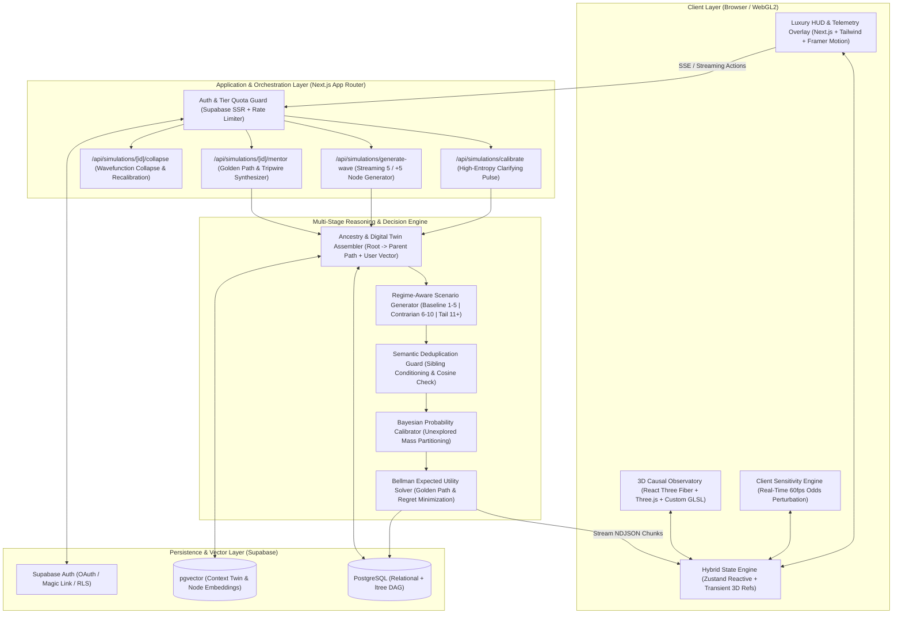
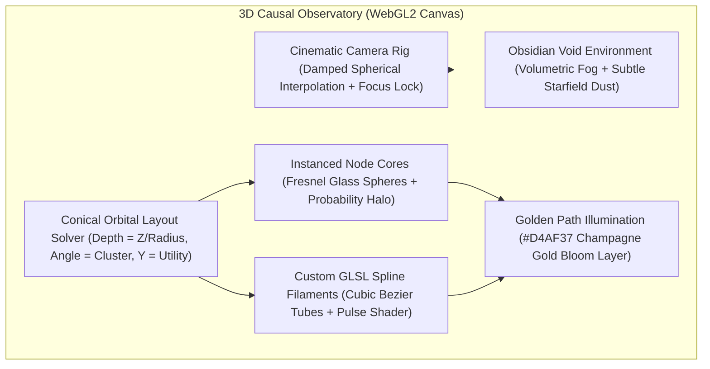

# High-Level Design (HLD)
## Project Codename: **KAIROS** — The AI Multiverse Decision & Probability Simulator

| Metadata | Details |
| :--- | :--- |
| **Document Version** | v1.0 |
| **Status** | Architecture Specification |
| **Target Stack** | Next.js (App Router, TypeScript), React Three Fiber / Three.js / Custom GLSL, Tailwind CSS, Supabase (PostgreSQL, Auth, pgvector), Structured LLM Reasoning Pipeline |
| **Related Docs** | [PRD.md](./PRD.md) · [LLD.md](./LLD.md) · [ROADMAP.md](./ROADMAP.md) |

---

## 1. Architectural Vision & Engineering Principles

KAIROS is not a chat wrapper; it is a **stateful, recursive probabilistic decision engine** paired with a **60 FPS 3D spatial observatory**. The architecture is governed by five core engineering principles:

1. **Hybrid Neuro-Symbolic Probability Engine**: LLMs excel at divergent causal reasoning and narrative generation, but struggle with raw probability arithmetic across expanding trees. KAIROS decouples **Qualitative Causal Generation (LLM)** from **Quantitative Bayesian Normalization & Expected Utility Math (Deterministic TypeScript Engine)**.
2. **Progressive Streaming Materialization**: Users must never stare at a blocking spinner for 15 seconds. As the AI generates each of the 5 futures (or `+5 More Possibilities`), individual nodes stream via Server-Sent Events (SSE) / ReadableStreams and physically crystallize into the 3D phase space in real time.
3. **Zero-Jank 60 FPS Spatial Rendering**: React state updates must never bottleneck the WebGL render loop. The 3D scene operates on transient Zustand references, instanced geometries, custom GLSL shaders, and spring-damped camera physics.
4. **Infinite Tree Scalability (`ltree` + DAG Storage)**: Because users can expand horizontally (`5 -> 10 -> 15 -> 20+` sibling possibilities) and dive vertically (`T0 -> T1 -> T2 -> ... -> Tn`) indefinitely, the database uses materialized path indexing (`ltree`) alongside adjacency lists for $O(1)$ subtree retrieval and ancestry conditioning.
5. **Context-Anchored Determinism ("No Generic Advice")**: Every simulation is conditioned on the user's persistent **Personal Context Digital Twin** (risk appetite, runway, core values, constraints) and pre-simulation clarifying signals.

---

## 2. System Context & Macro Architecture

---

## 3. Core Subsystem Architecture

### 3.1 The Multi-Stage AI Reasoning & Probability Pipeline
To prevent generic or repetitive outputs when a user clicks **"Simulate +5 More Possibilities"** or dives 5 levels deep into a timeline, KAIROS uses a four-stage orchestration pipeline:

#### Stage A: Pre-Simulation Calibration ("The Clarifying Pulse")
- When a user inputs an initial situation $S_0$, the system retrieves their **Personal Context Digital Twin** from Supabase.
- If high-entropy variables are missing (e.g., user asks about quitting their job, but financial runway or dependent obligations are unknown), the **Calibration Agent** generates **3 ultra-concise, multiple-choice/slider clarifying questions**.
- Users can answer in <15 seconds or click *"Simulate Immediately with Default Profile"* to bypass.

#### Stage B: Regime-Aware Divergent Wave Generation (`5 -> +5 -> +5`)
Every horizontal wave of 5 possibilities at a given node operates under a strict **Exploration Regime**:
- **Wave 1 (Nodes 1–5 — Baseline Canonical Regime)**: High-probability, mutually exclusive archetypes representing the primary statistical modes of reality (typically accounting for ~75%–85% of total probability mass).
- **Wave 2 (Nodes 6–10 — Second-Order & Contrarian Regime)**: Triggered when the user clicks **"+5 More Possibilities"**. The prompt explicitly passes Nodes 1–5 as *excluded semantic territories* and searches for non-linear second-order consequences, hidden bottlenecks, counter-intuitive market/human reactions, or psychological inflection points.
- **Wave 3+ (Nodes 11–15+ — Tail-Risk, Black Swan & Asymmetric Regime)**: Subsequent **"+5 More"** expansions probe the fat tails of the distribution—low-probability ($1\%–5\%$), extreme-magnitude trajectories (both catastrophic failure modes to hedge against and 10x breakout outcomes).

#### Stage C: Ancestral Path Conditioning (Infinite Vertical Recursion)
When a user selects *any* node $N_k$ at depth $d$ to simulate its future children at depth $d+1$:
1. The system queries the `ltree` ancestral chain: $[N_0 \to N_1 \to \dots \to N_k]$.
2. It constructs a **Causal Markov State Summary** encapsulating:
   - The root dilemma ($N_0$),
   - Every intermediate milestone and cumulative time elapsed ($T + \sum \Delta t_i$),
   - Any **User Intervention** injected at $N_k$ (e.g., *"At this point, I raise a bridge round"* vs. *"Passive auto-projection"*).
3. The LLM generates 5 child futures strictly conditioned on $N_k$ being the new present reality ($P(N_{k,j} \mid N_k)$).

#### Stage D: The Mentor & Golden Path Synthesizer
Rather than picking a branch arbitrarily, the Mentor Engine runs a **Multi-Objective Decision Analysis (MODA)** across the generated tree:
- Evaluates each path against the user's weighted **Core Value Vector** (e.g., Wealth, Autonomy, Mastery, Stability, Impact, Peace).
- Computes **Expected Utility ($E[U]$)**, **Reversibility Index** (Type 1 one-way door vs. Type 2 two-way door), and **10-Year Regret Minimization**.
- Backpropagates utility scores from leaf nodes to the root to illuminate the **Golden Path**—the sequence of decisions and outcomes that maximizes risk-adjusted long-term utility.
- Produces **Sensitivity Levers** (controllable input variables) and **Real-World Tripwires** (early-warning observable indicators over 30/60/90 days).

---

### 3.2 The 3D Spatial Observatory Engine ("Anti-Slop" Visual Architecture)

The primary interface of KAIROS is an interactive 3D phase-space canvas built with **React Three Fiber (R3F)**, **Three.js**, **Drei**, and **Custom GLSL Shaders**.

#### Key Spatial Engineering Decisions:
1. **Chronometric Orbital Coordinate System**:
   - **Origin ($0, 0, 0$)**: The user's current situation ($T_0$).
   - **Depth Rings ($Z$-axis & Radial Distance)**: Each recursive level ($T_1, T_2, T_3, \dots$) forms a deeper orbital stratum in 3D space.
   - **Azimuthal Distribution ($\theta$)**: Sibling possibilities fan out in an orbital arc around their parent's vector. Expanding **"+5 More Possibilities"** dynamically opens an outer concentric sub-ring or widens the sector with spring-physics relaxation so nodes never overlap.
   - **Elevation ($Y$-axis)**: Vertically encodes Expected Utility ($E[U]$)—high-utility / Golden Path trajectories ascend toward the upper phase space; high-risk / negative-utility paths dip into the lower amber/crimson stratum.
2. **Bioluminescent Probability Filaments (Custom GLSL)**:
   - Connections between parent and child nodes are rendered as smooth 3D Cubic Bezier tubes.
   - **Visual Encoding**:
     - **Thickness & Opacity** $\propto$ Conditional Probability $P(B \mid A)$.
     - **Energy Pulse Velocity** $\propto$ Time Horizon urgency ($1 / \Delta t$).
     - **Chromatic Spectrum**:
       - `#D4AF37` (Warm Champagne Gold): **The Golden Path** (Mentor recommended trajectory).
       - `#00F0FF` $\to$ `#10B981` (Spectral Cyan to Emerald): High-probability / positive-utility baseline branches.
       - `#8B5CF6` (Aether Violet): Contrarian / Second-order Wave 2+ branches.
       - `#F43F5E` / `#F59E0B` (Crimson / Amber): High-risk tail scenarios or failure modes requiring pre-mortem hedging.
3. **3-Tier Semantic Zoom (LOD)**:
   - **Macro View (Constellation Mode)**: Full multiverse overview; nodes appear as luminous stars with filament geometry; only root, Golden Path, and hovered node labels are visible.
   - **Meso View (Cluster Mode)**: Focused on a parent node and its 5–15 children; floating glassmorphic micro-badges display Title, $P\%$, and Time Horizon.
   - **Micro View (Nexus Inspection Mode)**: Camera dollies smoothly into a single selected node; the right-side **Tactile Telemetry HUD** slides in with full causal narrative, impact radar, sensitivity sliders, and action triggers (*"Simulate +5 More"*, *"Step Into This Future"*, *"Inject Action"*).

---

### 3.3 Hybrid State Management & Real-Time Streaming

To maintain a locked 60 FPS frame rate while streaming structured JSON from the LLM:
- **Zustand Store (`useMultiverseStore`)** is partitioned into:
  - **Reactive Graph Slice**: Normalized node map (`Record<NodeId, ProbabilityNode>`), active selection, hovered node, active camera mode, and Mentor synthesis state.
  - **Transient 3D Physics Slice (`useRef` / Non-Reactive)**: Current animated node positions, filament shader uniforms (`uTime`, `uHoverIntensity`, `uProbabilityShift`), and sensitivity slider multipliers read directly inside R3F's `useFrame()` loop without triggering React re-renders.
- **Partial JSON Streaming**:
  - The `/api/simulations/generate-wave` endpoint uses streaming structured generation.
  - As soon as Node #1 of a 5-node wave completes validation, it is flushed over the stream, inserted into the client graph, and materializes in 3D space with an orbital spring animation while Nodes #2–#5 are still generating.

---

## 4. Data Persistence & Multi-Tenancy Architecture (Supabase)

- **Authentication**: Supabase Auth supporting Email/Password, Magic Links, and Google/GitHub OAuth, plus an **Instant Guest Sandbox Mode** (persisted via anonymous session / local state and seamlessly upgradable to a full account).
- **Relational + Hierarchical Storage**:
  - PostgreSQL `ltree` extension stores the exact lineage of every node (e.g., `root.n1_3.n2_7.n3_2`), enabling instant queries such as *"Fetch all descendants of Node X"* or *"Fetch the exact ancestral spine from Root to Node Y"* in a single indexed SQL query.
- **Vector Memory (`pgvector`)**:
  - Stores embeddings of user situations, past decisions, and realized outcomes so the **Personal Context Digital Twin** learns the user's decision patterns over time.
- **Row-Level Security (RLS)**:
  - Every table (`profiles`, `user_context_twins`, `simulations`, `probability_nodes`, `mentor_syntheses`, `reality_checkins`) enforces strict `auth.uid() = user_id` policies at the database engine level.

---

## 5. Non-Functional Requirements & Performance Budgets

| Metric | Target SLA | Architectural Enforcement Mechanism |
| :--- | :--- | :--- |
| **3D Viewport Frame Rate** | **60 FPS** (Desktop) / **50+ FPS** (Mobile/Tablet) | `InstancedMesh` for node cores, frustum culling, adaptive DPR (`[1, 2]`), shader-based animations instead of DOM heavy overlays. |
| **Time to First Node (TTFN)** | **< 1.8 seconds** | Edge-compatible streaming route handlers; incremental array element streaming so Node 1 renders before Nodes 2–5 finish. |
| **Sensitivity Slider Latency** | **< 16ms (Instant / 60 FPS)** | Client-side Bayesian logit perturbation math executed synchronously in TypeScript without round-tripping to the LLM. |
| **Tree Scale Capacity** | **Up to 500+ nodes per canvas** | Normalized client map, GPU instancing, and semantic zoom LOD (culling distant HTML overlays beyond depth threshold). |
| **Accessibility & Fallback** | **WCAG AA + Reduced Motion Mode** | Keyboard-navigable tree hierarchy (`Arrow` keys to traverse parent/sibling/child nodes) and a synchronized 2D "Chronicle Matrix View" toggle. |
