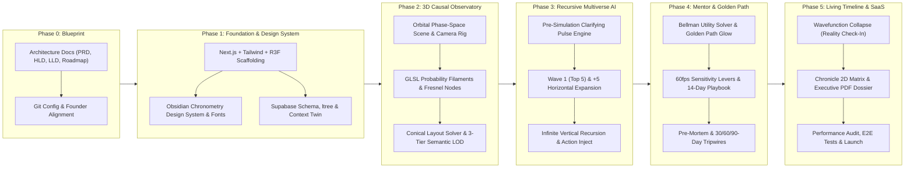

# Product & Engineering Execution Roadmap
## Project Codename: **HOROVEX** — The AI Multiverse Decision & Probability Simulator

| Metadata | Details |
| :--- | :--- |
| **Document Version** | v1.0 |
| **Execution Philosophy** | Architecture-First · Zero "AI Slop" · 60 FPS Spatial Luxury · Mathematically Grounded |
| **Related Docs** | [PRD.md](./PRD.md) · [HLD.md](./HLD.md) · [LLD.md](./LLD.md) |

---

## 1. Macro Execution Timeline

---

## 2. Detailed Phase Breakdown & Deliverables

### Phase 0: Architecture Blueprint & Founder Alignment *(Current Phase)*
**Objective**: Establish complete technical clarity, mathematical rigor, and aesthetic standards before writing a single line of application code.
- [x] **Product Requirements Document (`docs/PRD.md`)**: Vision, personas, core pillars, anti-slop luxury mandate, SaaS pricing tiers.
- [x] **High-Level Design (`docs/HLD.md`)**: System architecture, hybrid neuro-symbolic probability pipeline, 3D WebGL observatory design, state management.
- [x] **Low-Level Design (`docs/LLD.md`)**: Complete Supabase SQL DDL (`ltree`, `pgvector`, RLS), Bayesian unexplored mass partitioning math, Bellman Golden Path formula, Softmax sensitivity slider math, Zod schemas.
- [x] **Execution Roadmap (`docs/ROADMAP.md`)**: Phased build plan and quality gates.
- [x] **Git Workspace Configuration**: `.gitignore`, `.gitattributes`, repository initialization, and documentation index.
- [x] **Founder Alignment Gate**: Review clarifying questions on LLM provider preference, auth mode, and initial flagship templates.

---

### Phase 1: Core Scaffolding, Luxury Design System & Digital Twin Layer
**Objective**: Initialize the Next.js + React Three Fiber + Supabase stack and craft the **Obsidian Chronometry** visual foundation.
1. **Stack Initialization**:
   - Next.js (App Router, TypeScript strict mode), Tailwind CSS, `@react-three/fiber`, `@react-three/drei`, `@react-three/postprocessing`, `three`, `zustand`, `framer-motion`, `lucide-react`, `zod`.
2. **Obsidian Chronometry Design Tokens**:
   - Custom typography pairing: *Instrument Serif* (editorial narrative & Mentor insights), *Plus Jakarta Sans* (precision UI), *JetBrains Mono* (probability telemetry, $P\%$, $E[U]$, time horizons).
   - Glassmorphic surface system: Deep void obsidian (`#050507`), tungsten glass panels (`backdrop-blur-xl`), hairline specular borders (`1px solid rgba(255,255,255,0.08)`), champagne gold (`#D4AF37`), spectral cyan (`#00F0FF`), and emerald/amber/crimson status accents.
3. **Database & Personal Context Digital Twin**:
   - Supabase migration scripts for `profiles`, `user_context_twins`, `simulations`, `probability_nodes`, `mentor_syntheses`, and `reality_checkins`.
   - **Digital Twin Calibration Vault**: Interactive slide-over interface where users configure their baseline **Risk Appetite**, **Financial Runway**, and **6 Core Value Weights** (persisted to Supabase + local fallback so the app works immediately even in guest sandbox mode).

> **Phase 1 Quality Gate**: Zero generic UI components. Every button, slider, and telemetry badge must feel like a precision aerospace/horology instrument.

---

### Phase 2: The 3D Causal Observatory Engine (Three.js / R3F / GLSL)
**Objective**: Build the interactive 3D multiverse phase space capable of rendering 300+ probability nodes and glowing causal filaments at a locked 60 FPS.
1. **Phase Space Environment**:
   - Deep volumetric obsidian void, subtle concentric chronometric time rings ($T_0, T_1, T_2, \dots$), and depth-attenuated ambient dust particles.
2. **Conical Orbital Layout & Collision Relaxation Engine (`src/lib/math/spatialLayout.ts`)**:
   - Deterministic 3D coordinate solver mapping Depth $\to Z$, Sibling Cluster $\to \theta$, Wave Expansion $\to R$, and Expected Utility $\to Y$, followed by force-directed repulsion so nodes never overlap.
3. **Custom Shaders & Node Geometry**:
   - **Probability Nodes**: Glassmorphic Fresnel spheres with internal bioluminescent cores, breathing harmonic shaders, and orbital ring indicators for nodes that have child branches.
   - **Causal Filaments**: 3D Cubic Bezier tube splines with animated energy pulses whose thickness encodes $P(B \mid A)$ and pulse velocity encodes temporal urgency.
   - **The Golden Path Aura**: Selective bloom illumination in warm `#D4AF37` gold along the Mentor's optimal trajectory.
4. **Cinematic Camera Choreographer**:
   - Smooth spring-damped camera transitions when clicking a node, expanding `+5 More Possibilities`, diving into a child timeline, or toggling the Macro Constellation overview.

> **Phase 2 Quality Gate**: Must maintain 60 FPS during camera transitions and dynamic wave expansions with zero layout thrashing.

---

### Phase 3: The Recursive Multiverse AI Engine (`5 -> +5` & Infinite Depth)
**Objective**: Connect the multi-stage AI reasoning pipeline with Bayesian probability normalization and progressive streaming materialization.
1. **Stage A — The Clarifying Pulse (`/api/simulations/calibrate`)**:
   - Analyzes the user's input crossroads and generates 3 high-entropy clarifying questions to ground the simulation before generating Wave 1 (with a 1-click "Skip / Fast-Track" option).
2. **Stage B — Initial 5 Probabilities (Wave 1 — Baseline Regime)**:
   - Generates the 5 most probable, mutually distinct outcomes with calibrated conditional probabilities, time horizons, causal drivers, reversibility scores, and impact vectors.
3. **Stage C — Horizontal Expansion ("Simulate +5 More Possibilities")**:
   - **Wave 2 (Nodes 6–10)**: Second-order & contrarian scenarios, strictly conditioned on Nodes 1–5 to guarantee zero semantic overlap.
   - **Wave 3+ (Nodes 11–15 -> 20+)**: Tail-risk, Black Swan, and asymmetric upside trajectories, dynamically carving probability mass from the reserved $M_{\text{unexplored}}$ bucket and renormalizing sibling probabilities.
4. **Stage D — Infinite Vertical Recursion ("Step Into This Future")**:
   - Any node can become the new origin nexus.
   - Supports both **Passive Auto-Projection** (*"What happens next if this occurs?"*) and **Active User Intervention** (*"Assuming this happens, what if I take Action X?"*).

> **Phase 3 Quality Gate**: Expanding from 5 $\to$ 10 $\to$ 15 possibilities must produce genuinely deeper, non-repetitive insights, and probabilities across sibling branches must always remain mathematically coherent ($\sum P_i + M_{\text{unexplored}} = 100\%$).

---

### Phase 4: The AI Mentor, Golden Path & Real-Time Sensitivity Simulator
**Objective**: Transform the probability tree into an authoritative **Personal Strategic Advisor & Decision Engine**.
1. **Bellman Expected Utility Solver & Golden Path Highlighter**:
   - Evaluates every branch against the user's Digital Twin value weights, Reversibility Index, and 10-Year Regret Minimization Score.
   - Highlights the optimal multi-step trajectory in `#D4AF37` gold and generates the **Mentor Executive Verdict**.
2. **Interactive Sensitivity Levers ("How to Bend the Odds")**:
   - Real-time 60 FPS sliders (`Execution Velocity`, `Capital Buffer`, `Market Tailwind`, `Skill Preparation`) powered by the Softmax Logit Shift engine.
   - Moving a slider visibly shifts node sizes, filament luminosity, and probability percentages in real time.
3. **14-Day Actionable Playbook & Pre-Mortem Tripwires**:
   - Concrete actions the user can take *this week* to shift probability mass toward the Golden Path.
   - Observable **30/60/90-Day Tripwires** (real-world early warning indicators) that tell the user which branch is actually unfolding.

---

### Phase 5: Living Timeline ("Collapse the Wavefunction"), Export & SaaS Polish
**Objective**: Deliver long-term retention loops, executive export capabilities, and bulletproof production resilience.
1. **Reality Check-In ("Collapse the Wavefunction")**:
   - Allows the user to lock in which predicted branch actually materialized in real life, prune unrealized sibling branches, and promote the realized node to the new present origin ($T_0$).
2. **Synchronized 2D Chronicle Matrix & Executive Decision Dossier**:
   - A high-contrast tabular comparison view for rapid side-by-side analysis of all generated branches.
   - One-click export of the simulation, Golden Path rationale, and 14-day playbook into a clean Markdown/PDF **Executive Decision Brief**.
3. **Curated Flagship Demo Scenarios ("Instant Experience")**:
   - Pre-loaded interactive multiverse showcases (e.g., *Founder SaaS Pivot vs. Fundraising*, *Senior Engineer Leaving Big Tech for Solo AI Venture*, *Global Relocation & Capital Allocation*) so visitors experience the 3D observatory within 2 seconds of landing.

---

## 3. Definition of Done (DoD) Checklist
- [ ] **No Slop UI**: Zero generic gradients, zero unstyled markdown dumps, zero stock chatbot bubbles.
- [ ] **True Recursion**: Verified horizontal expansion (`5 -> 10 -> 15+`) and vertical recursion (`T0 -> T1 -> T2 -> T3+`) working seamlessly on any node.
- [ ] **Mathematical Integrity**: Conditional and cumulative probabilities always sum cleanly and respond dynamically to Sensitivity Levers.
- [ ] **Mentor Authority**: Every simulation produces a clear Golden Path, concrete rationale, pre-mortem risks, and actionable next steps.
- [ ] **Dual Persistence**: Seamless operation with both Supabase cloud persistence and instant local/guest sandbox resilience.
